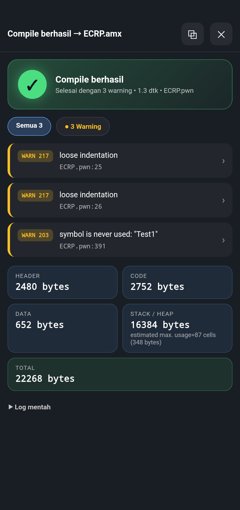
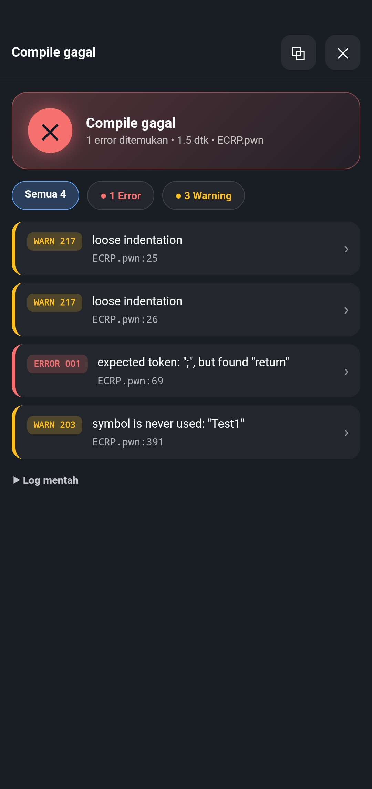
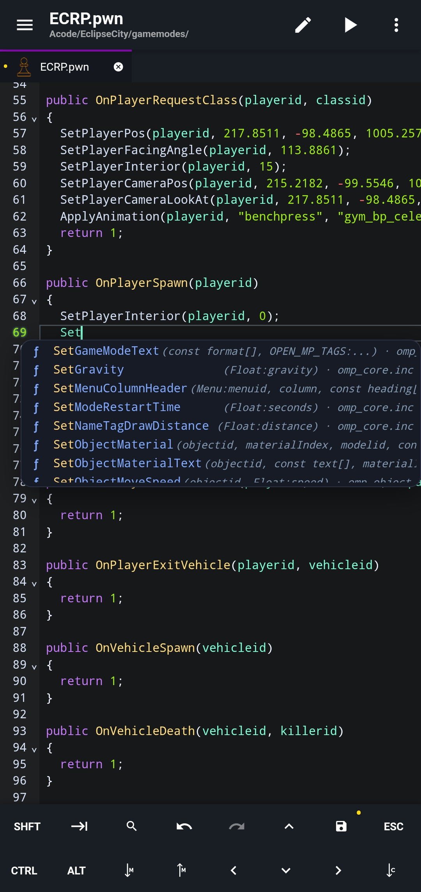

<div align="center">


# Pawno Compiler

**Write, highlight and compile Pawn (SA-MP / open.mp) right inside Acode.**
No PC. No Pawno. Just your phone.


</div>

---

## ✨ Overview

Pawno Compiler turns Acode into a pocket Pawn IDE. Open a `.pwn` file, tap **▶**, and get a clean result screen with errors, warnings and size stats. Tap any error to jump straight to the line.

It ships with its own `pawncc.wasm`, so it works **out of the box without Alpine or a terminal**. If you prefer a native compiler, an Alpine (proot) mode is built in as well.

<p align="center">
  
  
  
</p>

## 🚀 Features

### ⚙️ Compiling
- **One-tap compile** from a **▶** button in the header. It only appears for `.pwn`, `.p` and `.inc` files.
- **Built-in `pawncc.wasm` engine**: no Alpine, no terminal, no setup.
- **Alpine (proot) mode** as an alternative, using a native `pawncc`.
- **Auto-install of `pawncc`** for Alpine mode: runs in a real Acode terminal so you can watch progress.
- **Auto-save** before compiling (can be turned off).
- **Compile `.inc` files** by pointing to a `main` file in `task.json`.
- Output `.amx` is written next to your source, **only when the compile succeeds**.
- Configurable **compiler flags** (default `-d3 -;+ -(+`) and **extra include folders**.

### 📋 Result screen
- Clear **success / failed** banner with compile time.
- **Error and warning list** with filter chips (All / Errors / Warnings).
- **Tap to jump** to the exact line, including errors inside included files.
- **Size stats** cards: Header, Code, Data, Stack / Heap, Total.
- **Raw log** view and one-tap **copy log**.

### 🗂️ Project support (`.acode/task.json`)
- Per-project flags, include paths and compiler command.
- `main` entry so you can press compile while editing an `.inc`.
- Variables: `${file}`, `${fileDirname}`, `${fileBasename}`, `${fileBasenameNoExtension}`, `${fileExtname}`, `${relativeFile}`, `${workspaceRoot}` (alias `${workspaceFolder}`).
- JSON with comments and trailing commas is accepted.

### 🧠 Editor
- **Syntax highlighting** for `.pwn` and `.inc` (CodeMirror 6).
- **Pawno Night** theme.
- **Autocomplete & snippets**: callbacks, natives, constants, keywords and common snippets.
- **Project-aware suggestions**: symbols from your `.inc` files and from module files inside your `gamemode` / `gamemodes` folder.
- **`.pwn` file icon** in tabs and sidebar (icon pack).

## 🧩 Usage

1. Open a `.pwn` file.
2. Tap **▶** in the header.
3. Read the result. Tap an error to jump to it.

### Example `.acode/task.json`

```json
{
  "version": "1.0",
  "tasks": [
    {
      "label": "build",
      "main": "gamemodes/ECRP.pwn",
      "args": ["${file}", "-D${fileDirname}", "-;+", "-(+", "-d3"],
      "includes": ["${workspaceRoot}/qawno/include"],
      "group": { "kind": "build", "isDefault": true }
    }
  ]
}
```

> When a project has a `task.json`, it takes priority over the flags set in plugin settings.

## 🛠️ Settings

| Setting | What it does |
| --- | --- |
| Path pawncc | Command or path of `pawncc` inside the terminal (Alpine mode) |
| Setup command | Custom shell script to install `pawncc`. Empty = build from source |
| Compiler flags | Flags passed to `pawncc` (default `-d3 -;+ -(+`) |
| Extra include folders | Comma-separated include folders, e.g. `/sdcard/Acode/pawno/include` |
| Use pawncc.wasm | Compile with the built-in engine (no Alpine needed) |
| Run in Alpine | Use the Alpine (proot) environment |
| Auto-save before compile | Save the active file first |
| Autocomplete & snippets | Pawn suggestions and snippets |
| Pawn syntax highlighting | Highlighting for `.pwn` / `.inc` (restart Acode to apply) |

## ⌨️ Commands

Open the command palette and search for **Pawn**:

| Command | Description |
| --- | --- |
| `Pawn: Compile active file` | Compile the current file |
| `Pawn: Setup compiler (install pawncc)` | Install `pawncc` for Alpine mode |
| `Pawn: Remove setup (pawncc & settings)` | Remove the installed compiler and reset settings |
| `Pawn: Use Pawno Night theme` | Switch to the Pawno Night theme |
| `Pawn: Debug .pwn icon` | Diagnose the file icon |
| `Pawn: Debug autocomplete` | Show what autocomplete has scanned |

## 🙏 Credits

- [Pawn](https://github.com/pawn-lang/compiler) compiler by CompuPhase and the Pawn community.
- [Acode](https://acode.app) editor.
- Built by **ZafarRY**.

## 📄 License

**All rights reserved.** This project is proprietary. Copying, cloning, forking, modifying or redistributing the source is not permitted without written permission from the author. See [LICENSE](LICENSE).
